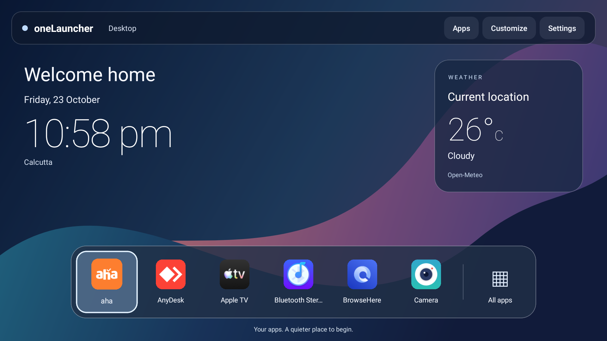

# oneLauncher

A JavaScript-first home screen for **Android TV 10+**, with a desktop-inspired
design and phone-controlled personalization. Built with React Native TV and a
small Kotlin integration layer.



## Try the beta

Download the APK from [GitHub Releases](https://github.com/dharshakch97/oneLauncher/releases).
Supports ARM32 and ARM64 Android TVs. Tested on a OnePlus C00 running Android 10;
other TV models may handle Home selection and location differently. Samsung
Tizen, LG webOS, Roku and Apple TV are not supported.

1. Install the APK on your TV and open **oneLauncher** from Apps.
2. Check remote navigation, app launching and the Settings shortcut.
3. Choose oneLauncher as the default Home app if your TV offers that option.
4. Open **Customize → Start phone connection** and scan the QR with your phone
   camera while connected to the same Wi-Fi.

Read [installation and recovery](docs/INSTALLATION.md) before changing default
Home. Installing the APK does not disable or replace the stock launcher.

## Features

- Original abstract wallpaper, translucent menu bar and floating app dock.
- Installed TV app grid, remote focus, app launching and Android Settings shortcut.
- Wallpaper upload from a phone browser, with QR pairing or a six-digit code.
- Editable home name or welcome message; leave it empty to hide it.
- Main clock and two optional world clocks, with separate time zones and 12/24-hour format.
- Approximate-location weather and city search powered by Open-Meteo.
- Private on-device settings and wallpaper storage; no oneLauncher account needed.

The dock currently shows the first six TV apps alphabetically. Favorites, HDMI
shortcuts and screen-time tracking are not included. This is a beta, not a Google
Play release.

## Personalize from your phone

1. On the TV select **Customize → Start phone connection**.
2. Scan the QR. It opens the phone page and pairs automatically. Alternatively,
   open the displayed address and enter the six-digit code.
3. Choose a photo, check its preview and press **Apply wallpaper**.
4. Edit the home name and time zones, then press **Save home settings**.
5. Leave Customize or select **Disconnect phone** when finished.

The connection closes after ten minutes, when leaving Customize, or when the
app goes into the background. Reopen it for a fresh code. No phone app is needed.
Both devices must be on the same trusted network; guest Wi-Fi isolation or a VPN
may block the connection. Photos are resized on the phone and TV; uploads are
limited to 8 MB. JPEG, PNG and WebP are supported by Android; the phone page
converts supported photos to JPEG.

For weather, select **Use current location**, grant approximate location and
enable system Location on the TV. If the firmware cannot supply a location,
choose a city on the phone page. Clocks do not change the TV's system time zone.

## Build and contribute

Install Node.js 22.11+, Java 17 and the Android SDK as described in the
[build guide](docs/BUILDING.md), then:

```sh
git clone https://github.com/dharshakch97/oneLauncher.git
cd oneLauncher
npm ci
npm run lint
npm test -- --watchman=false
npm run test:android
npm run build:android
```

Release-mode builds are **unsigned** unless private signing variables are set.
For an installable development build use `npm run android`; for a signed release,
follow [RELEASING.md](docs/RELEASING.md). Public releases never use the shared
debug key. Version and Android version code live in `package.json`.

## Code layout

| Path | Purpose |
| --- | --- |
| `App.js` | Launcher components, state and event handlers |
| `src/styles/launcher.js` | Launcher styles |
| `src/home.js`, `src/apps.js` | Settings, clocks, weather and app helpers |
| `android/app/src/main/assets/companion.html` | Phone page markup |
| `android/app/src/main/assets/companion.js` | Phone page behavior |
| `android/app/src/main/assets/companion.css` | Phone page styles |
| `android/app/src/main/java/com/onelauncher/` | Android integration and local server |
| `__tests__/`, `android/app/src/test/` | JavaScript and JVM tests |
| `.github/workflows/` | Automated checks and tagged releases |

## Privacy and compatibility

Photos and personalization stay in the TV's private app storage. Local transfers
use HTTP on your home network. The QR contains a temporary pairing code; treat it
like a temporary password. Weather and city search use Open-Meteo; weather
requests include the selected coordinates. See [PRIVACY.md](docs/PRIVACY.md).

Early test builds used a different signing key. They cannot be updated with the
public APK. Restore a working stock Home before uninstalling an old test build;
uninstalling erases settings. See [recovery](docs/INSTALLATION.md#recovery).

## License

[MIT](LICENSE). See [third-party notices](THIRD_PARTY_NOTICES.md) for dependencies
and weather-service terms. Contributions and bug reports are welcome; include
the TV model, Android version, app version and steps to reproduce.
